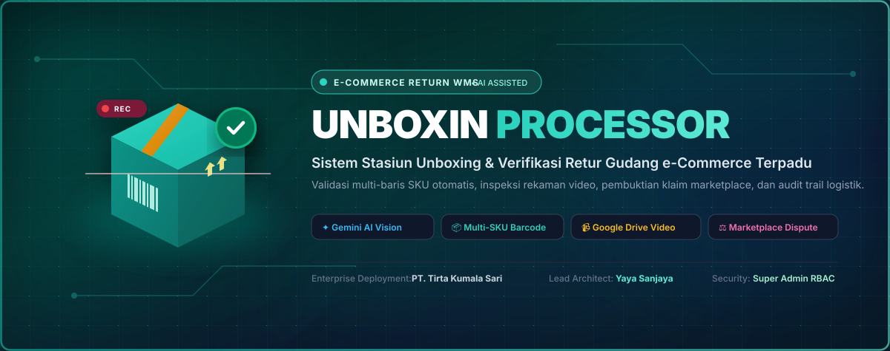

<div align="center">

  

  <h1>Unboxin</h1>

  <p>Sistem Manajemen Stasiun Unboxing &amp; Verifikasi Retur Gudang e-Commerce PT. Tirta Kumala Sari</p>

  <a href="https://ais-dev-kiiarpri7cmp7ccjkir7ls-160608231505.asia-southeast1.run.app">🚀 <b>Buka Stasiun Unboxin</b></a>
  &nbsp;•&nbsp;
  <a href="#fitur-utama">✨ <b>Fitur Utama</b></a>
  &nbsp;•&nbsp;
  <a href="#alur-kerja-stasiun">📦 <b>Alur Kerja Stasiun</b></a>
  &nbsp;•&nbsp;
  <a href="#hak-akses--keamanan">🔒 <b>Hak Akses &amp; RBAC</b></a>

</div>

<br />

---

## 📌 Ringkasan Sistem

**Unboxin Processor** adalah platform workstation terintegrasi yang dirancang khusus untuk operasional gudang retur e-commerce (Shopee, Tokopedia, TikTok Shop, Lazada, Blibli). Sistem ini menyatukan proses pemindaian paket (*Order ID / Resi / SKU*), perekaman video unboxing berbasis browser dengan timestamp nyata (*watermark*), integrasi AI multimodal Gemini untuk verifikasi kondisi produk, sinkronisasi file video ke Google Drive, serta manajemen klaim sengketa retur secara transparan dan akuntabel.

Dikembangkan untuk **PT. Tirta Kumala Sari** dengan arsitektur rekayasa oleh **Yaya Sanjaya**, sistem ini menyelesaikan masalah klasik penanganan retur e-commerce:
1. **Bukti video hilang atau tidak teratur** saat mengajukan komplain retur rusak/salah ke marketplace.
2. **Kesesuaian isi paket retur** (apakah produk yang dikembalikan pembeli sesuai dengan SKU asli atau barang palsu/bekas/rusak).
3. **Pencatatan manual yang lambat dan rawan manipulasi** oleh operator lapangan.

---

## ✨ Fitur Utama

### 1. 📦 Stasiun Unboxing Cepat & Cerdas (Smart Inspection Station)
- **Multi-SKU Verification**: Operator cukup scan nomor order atau resi; sistem otomatis mencocokkan daftar barang dalam pesanan terhadap Master Database SKU.
- **Perekaman Video Langsung & Standarisasi Nama File**: Kamera merekam seluruh proses buka paket dan otomatis memberi penamaan terstandar: `Order_Waktu.webm` atau `Tgl_Order_SKU_Kondisi.mp4`.
- **Integrasi Cloud Storage & Direct Video Link**: Tautan video langsung menuju file video di Google Drive (atau pencarian folder otomatis) sehingga bukti video siap disertakan dalam formulir banding marketplace.

### 2. 🧠 Verifikasi Berbantuan AI (Gemini Multimodal Vision & Audio)
- **Analisis Ucapan Operator**: Sistem mendeteksi ucapan operator saat unboxing (misal: *"kemasan sobek"*, *"segel hilang"*, *"warna berbeda"*), dan otomatis mencocokkan ke kategori kondisi resmi.
- **Pemeriksaan Visual**: Deteksi cacat fisik produk langsung dari tangkapan frame video unboxing.

### 3. 📊 Dashboard Analisis & Rekap Retur Eksekutif
- **Metrik KPI Real-time**: Total pesanan retur, total unit, rasio kerusakan (*Defect Rate*), dan estimasi total nilai kerugian retur.
- **Tren Harian & Bulanan**: Grafik interaktif volume retur per hari/bulan untuk mendeteksi lonjakan komplain.
- **Top 5 SKU Retur Terbanyak**: Identifikasi produk yang paling sering dikembalikan oleh pembeli.
- **Distribusi Saluran Logistik**: Analisis retur berdasarkan kurir & marketplace (Shopee Express, J&T, JNE, Ninja, SiCepat).

### 4. ⚖️ Manajemen Klaim Sengketa Retur (Marketplace Dispute Center)
- **Pelacakan Status Klaim**: Status berkas sengketa (*Draft, Diajukan, Dalam Investigasi, Disetujui, Ditolak*).
- **Generator Dokumen Banding**: Pembuatan template surat bantahan resmi yang memuat nomor pesanan, kronologi kerusakan, dan link video unboxing sebagai bukti otentik.
- **Monitoring Nilai Pengembalian Dana**: Penghitungan nilai klaim yang berhasil dimenangkan dari pihak marketplace/ekspedisi.

### 5. 🗄️ Master Database SKU & Import Excel
- **Katalog Produk Dinamis**: Data master SKU, Barcode/UPC, Nama Produk, Kategori, dan Nilai Satuan (Rupiah).
- **Import & Export Cepat**: Dukungan penuh format Excel (`.xlsx`) dan CSV dengan validasi otomatis.

### 6. 🛡️ Keamanan Bertingkat & Hak Akses (Role-Based Access Control)
- **Super Admin**: Akses penuh untuk manajemen pengguna, pergantian password/PIN darurat, penghapusan baris laporan unboxing, serta pengaturan master data.
- **Manager Gudang**: Verifikasi laporan, persetujuan klaim marketplace, dan analisis performa logistik.
- **Operator QC / Stasiun**: Antarmuka terfokus untuk input resi, perekaman kamera video, dan pencatatan kondisi barang.
- **Audit Trail & Proteksi PIN**: Konfirmasi dialog in-app untuk tindakan destruktif mencegah penghapusan data secara tidak sengaja.

---

## 🛠️ Arsitektur Teknologi

```text
┌─────────────────────────────────────────────────────────────┐
│                    UNBOXIN PROCESSOR                        │
│             Frontend: React 19 + TypeScript + Vite          │
│               Styling: Tailwind CSS v4 + Lucide Icons       │
└──────────────┬───────────────────────────────┬──────────────┘
               │                               │
    ┌──────────▼──────────┐         ┌──────────▼──────────┐
    │  Stasiun Kerja QC   │         │  Admin & Executive  │
    │  • MediaRecorder    │         │  • KPI Dashboard    │
    │  • Barcode Scanner  │         │  • Dispute Claims   │
    │  • Speech / Gemini  │         │  • Master Database  │
    └──────────┬──────────┘         └──────────┬──────────┘
               │                               │
┌──────────────▼───────────────────────────────▼──────────────┐
│                    Koneksi & Penyimpanan                    │
│   • Google Drive API & OAuth Workspace (Video Cloud Store)  │
│   • Firebase Firestore (Realtime Database & Security Rules) │
│   • LocalStorage Persistence (Fallback Offline Gudang)      │
└─────────────────────────────────────────────────────────────┘
```

---

## 📦 Alur Kerja Stasiun (Step-by-Step)

```text
1. Scan Barcode / Resi Paket Retur
   └── Sistem mencari detail pesanan di database

2. Mulai Perekaman Video Unboxing
   └── Kamera stasiun merekam proses pembukaan lakban & segel
   └── Operator dapat menyuarakan kondisi fisik produk

3. Input & Cocokkan Kondisi Produk
   └── Pilihan: Baik (Good), Kerusakan Kemasan, Kerusakan Produk, Hilang, Salah Barang
   └── Gemini AI membantu memberi rekomendasi keparahan cacat

4. Selesai & Simpan Laporan
   └── Video diarsip secara lokal atau otomatis diunggah ke Google Drive
   └── Tautan bukti langsung tersimpan di baris laporan unboxing

5. Penanganan Sengketa (Bila Rusak)
   └── Tim Admin meneruskan data laporan dan tautan video ke portal klaim marketplace
```

---

## 🚀 Panduan Memulai Cepat

### Prasyarat
- Node.js versi 18 atau lebih baru
- Web browser modern dengan izin kamera & mikrofon (Google Chrome / Edge direkomendasikan)

### Instalasi & Menjalankan

```bash
# Clone repository
git clone https://github.com/user-attachments/unboxin-processor.git
cd unboxin-processor

# Install dependensi
npm install

# Jalankan server pengembangan
npm run dev
```

Aplikasi akan berjalan di `http://localhost:3000`.

---

## 🔒 Konfigurasi Akun Default

| Peran (Role) | Nama Akun | PIN Cepat | Kewenangan |
|---|---|---|---|
| **SUPER_ADMIN** | Super Administrator (Yaya) | `1234` | Kontrol penuh, kelola akun, hapus data |
| **MANAGER** | Warehouse Manager | `1234` | Dashboard, persetujuan klaim, ekspor laporan |
| **QC_OPERATOR** | Stasiun QC Operator 1 | `1234` | Operasional stasiun unboxing & input laporan |

> *Catatan Keamanan: PIN default dapat diperbarui sewaktu-waktu melalui menu **Kelola Akun** oleh Super Admin.*

---

## 📄 Lisensi & Hak Cipta

- **Perusahaan**: PT. Tirta Kumala Sari
- **Hak Cipta**: © 2026 Yaya Sanjaya. Seluruh Hak Cipta Dilindungi.
- **Sistem**: Unboxin Processor — E-Commerce Return Warehouse WMS.
